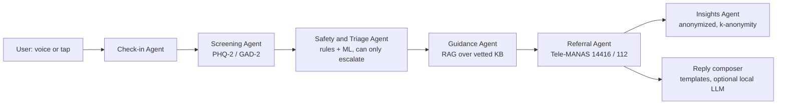

# Mello (मनमित्र)

**A voice-first AI agent for early mental-distress check-ins and referral for India's informal workforce.**
Built for the IBM SkillsBuild x AICTE x BharatCares (CSRBOX) Machine Learning & Applied AI Internship 2026 (SDG 3: Good Health and Well-being).

> **Status: research prototype, not a medical device.** Mello is a screening and support tool. It does not diagnose or treat anyone. The knowledge base and screening wording are drafts that need clinical review before any real-world use. See [docs/SAFETY.md](docs/SAFETY.md).

## Why
Roughly 80% of people with common mental disorders in India never receive care (National Mental Health Survey 2015-16). The national helpline Tele-MANAS (14416) exists, but people must make the first call. Informal workers (delivery riders, domestic and construction workers, small shopkeepers) face long hours, stigma, low literacy and no HR support, and most wellness apps assume English, text and a private smartphone. Mello is a friendly bridge: a short voice check-in in the user's own language that notices early distress and points to human help.

## What it does
1. Asks 5 short screening questions (PHQ-2 / GAD-2 style plus a sleep item) in Hindi or English, by tapping or speaking.
2. Optionally reads free text and checks it with a transparent **crisis rule layer** plus an **ML text classifier**.
3. Assigns a tier: **Green** (tips), **Amber** (guided coping and a nudge to talk to someone), **Red** (immediate handoff to Tele-MANAS 14416 and 112 for immediate danger).
4. Retrieves coping tips from a **vetted knowledge base** (RAG). Tips are never invented by a model.
5. Stores only anonymized aggregates for NGO and CSR partners, with small-cell suppression.

## Architecture

Details: [docs/ARCHITECTURE.md](docs/ARCHITECTURE.md). Mapping to the IBM SkillsBuild topics: [docs/IBM_LEARNING_MAP.md](docs/IBM_LEARNING_MAP.md).

## Quick start (free, no accounts)
Requires Python 3.10+.
```bash
git clone <your-repo-url> && cd mello
pip install -r requirements.txt
python scripts/train_classifier.py        # trains the text model, writes models/
PYTHONPATH=src python -m mello.server # open http://127.0.0.1:8000
```
Other commands: `make test`, `make cli` (terminal check-in), `make demo-data` (fills the dashboard with **synthetic** data).
On Windows PowerShell set the path first: `$env:PYTHONPATH="src"`. Alternatively `pip install -e .` and use `mello-server`.

Voice input and spoken questions use the browser's built-in speech features (Chrome or Edge). The server-side Whisper option is in [src/mello/speech.py](src/mello/speech.py) (`pip install faster-whisper`).

## Project layout
```
src/mello/   agents.py (6 agents + orchestrator), screening.py, safety.py, classifier.py,
                 rag.py, generator.py, insights.py, themes.py, speech.py, server.py, cli.py
data/            questions.json, knowledge_base.json (DRAFT), seed_text_dataset.csv (SYNTHETIC)
frontend/        index.html (talks to the API; falls back to offline logic if no server)
scripts/         train_classifier.py, seed_demo_data.py
tests/           24 unit and integration tests (stdlib unittest)
docs/            architecture, safety, datasets, deployment, IBM mapping, viva Q&A, submission files
```

## Tests and honest metrics
`make test` runs 24 tests covering scoring, parsing, crisis rules (including false-alarm checks), the classifier, retrieval, the full agent pipeline (a crisis phrase is always red; the model can never lower a tier), small-cell suppression and the HTTP API.

| Metric (5-fold CV on the bundled **synthetic** 100-row dataset) | Value |
|---|---|
| Text model alone, crisis recall | 0.62 |
| Rules + model, crisis recall (optimistic: rules were written while looking at this data) | 0.97 |

The model alone is weak because the data is tiny and synthetic. That is exactly why safety does not depend on it: the rule layer decides red, and the model may only escalate. Do not quote these numbers as real-world performance. Real evaluation needs consented, professionally labelled data ([docs/DATASETS.md](docs/DATASETS.md)).

## Known limitations
- Synthetic seed data; no real-world accuracy claims.
- Hindi and Hinglish crisis rules are a starting list, not exhaustive. Other Indian languages are not covered yet.
- Screening wording is adapted, not the validated Hindi or regional instrument versions.
- Browser speech recognition varies by device, accent and noise; not tested on real worker speech.
- No authentication, since there are no user accounts by design. A real deployment needs a proper privacy and consent review.

## Roadmap
See [docs/ROADMAP.md](docs/ROADMAP.md). Highlights: clinician review, validated instruments, real datasets, Whisper evaluation on Indian-language speech, WhatsApp/IVR delivery with an NGO partner, more languages.

## Submission documents
Concept Note, Lean Canvas and presentation are in [docs/submission/](docs/submission/).

## Sources
National Mental Health Survey of India 2015-16 (NIMHANS); Tele-MANAS, Ministry of Health and Family Welfare (14416, 1-800-891-4416); PHQ-2 and GAD-2 standard screening cut-offs (>= 3).

## License
MIT. See [LICENSE](LICENSE).
